# Database schema and ERD

WasteWise uses **PostgreSQL**. The schema is owned by the TypeORM migrations in
`backend/src/database/migrations`; this page documents the result after all 8 migrations
(latest: `AddSchemaHardeningConstraints`). 17 application tables plus TypeORM's `migrations`
bookkeeping table, 16 foreign keys and 5 enum types.

| File | Purpose |
|---|---|
| [`database.dbml`](database.dbml) | Full schema in DBML: columns, types, defaults, indexes, check constraints and relations |
| This page | Entity-relationship diagram (Mermaid, rendered by GitHub) and table reference |

## View or export the diagram in dbdiagram.io

1. Open <https://dbdiagram.io/d>.
2. Paste the contents of [`database.dbml`](database.dbml) into the editor.
3. Export with **Export > PNG / PDF / SQL**.

`database.dbml` is a snapshot of the migrations. When an entity changes, add a reviewed
migration first (see [Development](DEVELOPMENT.md)) and update the DBML to match; run
`bun run schema:check` to confirm entities and migrations agree.

## Entity-relationship diagram

`||--o{` means one-to-many and `||--o|` means one-to-one. Only foreign keys that exist in the
database are drawn.

```mermaid
erDiagram
    media ||--o{ reports : "mediaId"
    media ||--o| users : "avatarId"
    permissions ||--o{ role_permissions : "permissionId"
    permissions ||--o{ user_permissions : "permissionId"
    roles ||--o{ role_permissions : "roleId"
    roles ||--o{ user_roles : "roleId"
    users ||--o{ audit_logs : "actorId"
    users ||--o{ invitations : "invitedBy"
    users ||--o{ media : "userId"
    users ||--o{ notifications : "userId"
    users ||--o{ notifications : "actorId"
    users ||--o{ reports : "reporterId"
    users ||--o{ user_permissions : "userId"
    users ||--o{ user_roles : "userId"
    users ||--o{ user_sessions : "userId"
    users ||--o{ user_sessions : "impersonatedById"
    audit_logs {
        varchar eventId
        int id PK
        varchar action
        int actorId FK
        varchar actorEmail
        varchar subjectType
        varchar subjectId
        varchar summary
        jsonb metadata
        varchar ipAddress
        timestamptz createdAt
    }
    blacklisted_tokens {
        int id PK
        varchar token UK
        varchar reason
        timestamptz invalidatedAt
    }
    email_verification_tokens {
        int id PK
        varchar token UK
        int userId
        timestamptz expiresAt
        timestamptz usedAt
        timestamptz createdAt
    }
    invitations {
        int id PK
        varchar token UK
        varchar email
        text roleIds
        int invitedBy FK
        timestamptz expiresAt
        timestamptz acceptedAt
        timestamptz createdAt
        timestamptz deletedAt
    }
    media {
        int id PK
        varchar provider
        varchar filename
        varchar originalName
        varchar mimetype
        bigint size
        varchar path
        varchar url
        varchar driveId
        varchar webviewLink
        int userId FK
        boolean isPrivate
        timestamptz createdAt
        timestamptz updatedAt
        timestamptz deletedAt
        varchar storageProfile
        varchar storageFingerprint
        varchar state
        varchar remoteName
        timestamptz cleanupAt
        timestamptz cleanupLeaseUntil
        uuid cleanupLeaseToken
        int cleanupAttempts
        varchar cleanupErrorCode
    }
    notifications {
        varchar eventId
        int id PK
        int userId FK
        varchar targetRole
        int actorId FK
        varchar title
        text message
        notifications_type_enum type
        boolean isRead
        varchar link
        timestamptz createdAt
        timestamptz updatedAt
    }
    outbound_emails {
        int id PK
        varchar to
        varchar subject
        text html
        text text
        varchar status
        int attempts
        timestamptz nextAttemptAt
        text lastError
        timestamptz sentAt
        boolean redactAfterSend
        timestamptz expiresAt
        timestamptz createdAt
    }
    password_reset_tokens {
        int id PK
        varchar token UK
        int userId
        timestamptz expiresAt
        timestamptz usedAt
        timestamptz createdAt
    }
    permissions {
        int id PK
        varchar name UK
        varchar description
        timestamptz createdAt
        timestamptz updatedAt
        timestamptz deletedAt
    }
    reports {
        int id PK
        int reporterId FK
        int mediaId FK
        text description
        numeric latitude
        numeric longitude
        reports_predicted_category_enum predictedCategory
        numeric confidence
        varchar modelVersion
        reports_classification_status_enum classificationStatus
        varchar classificationError
        reports_status_enum status
        timestamptz createdAt
        timestamptz updatedAt
        timestamptz deletedAt
    }
    role_permissions {
        int roleId PK,FK
        int permissionId PK,FK
    }
    roles {
        int id PK
        varchar name
        varchar description
        timestamptz createdAt
        timestamptz updatedAt
        timestamptz deletedAt
    }
    two_factor_recovery_codes {
        int id PK
        int userId
        varchar codeHash
        timestamptz usedAt
        timestamptz createdAt
    }
    user_permissions {
        int userId PK,FK
        int permissionId PK,FK
    }
    user_roles {
        int userId PK,FK
        int roleId PK,FK
    }
    user_sessions {
        int id PK
        varchar sessionId UK
        int userId FK
        varchar ipAddress
        text userAgent
        int impersonatedById FK
        varchar audience
        timestamptz lastActiveAt
        timestamptz expiresAt
        timestamptz absoluteExpiresAt
        timestamptz revokedAt
        timestamptz createdAt
        timestamptz updatedAt
        timestamptz deletedAt
    }
    users {
        varchar timeZone
        varchar lastDetectedTimeZone
        int id PK
        varchar email
        varchar password
        varchar fullname
        varchar phone
        boolean notificationsEnabled
        timestamptz emailVerifiedAt
        int failedLoginAttempts
        timestamptz lockedUntil
        text twoFactorSecret
        timestamptz twoFactorEnabledAt
        bigint twoFactorLastStep
        users_register_method_enum registerMethod
        timestamptz createdAt
        timestamptz updatedAt
        timestamptz deletedAt
        int avatarId FK,UK
        boolean isActive
    }
```

## Tables

| Group | Table | Purpose |
|---|---|---|
| Reports | `reports` | Waste reports: description, GPS, status, and the AI result (`predictedCategory`, `confidence`, `modelVersion`, `classificationStatus`, `classificationError`) |
| | `media` | Uploaded files with storage state and cleanup lease; each report references one photo |
| Identity | `users` | Accounts (soft delete, `registerMethod`, active flag, optional avatar in `media`) |
| | `roles`, `permissions` | RBAC definitions |
| | `user_roles`, `role_permissions`, `user_permissions` | Many-to-many joins |
| | `user_sessions` | Device sessions with `audience` (`admin` or `mobile`), idle and absolute deadlines |
| | `invitations` | Admin invitations (`roleIds` is stored as text) |
| Auth tokens | `password_reset_tokens`, `email_verification_tokens`, `two_factor_recovery_codes` | Single-use tokens and recovery codes; each has a `userId` column |
| | `blacklisted_tokens` | Revoked access tokens |
| Platform | `notifications` | In-app notifications (`type` enum, recipient `userId`, optional `actorId`) |
| | `audit_logs` | Append-only audit trail |
| | `outbound_emails` | SMTP outbox with retry fields |

### Relationships worth knowing

- A report belongs to one reporter (`reports.reporterId`) and one photo (`reports.mediaId`).
  Both foreign keys use `ON DELETE RESTRICT`, so a user or photo with reports cannot be
  hard-deleted; business tables use soft delete (`deletedAt`).
- Deleting a user cascades to their sessions, notifications and role/permission joins.
  Audit log, invitation, notification actor and impersonation references are set to `NULL`.
- `password_reset_tokens`, `email_verification_tokens` and `two_factor_recovery_codes` store
  `userId` **without a foreign key constraint**, so they are not drawn in the diagram.

### Enums

| Enum | Values |
|---|---|
| `reports_status_enum` | `PENDING`, `IN_PROGRESS`, `COMPLETED`, `REJECTED` |
| `reports_predicted_category_enum` | `ORGANIC_WASTE`, `PLASTIC_WASTE`, `PAPER_WASTE` |
| `reports_classification_status_enum` | `COMPLETED`, `FAILED` |
| `users_register_method_enum` | `EMAIL_OTP`, `GOOGLE`, `INVITATION`, `SEEDER`, `UNKNOWN` |
| `notifications_type_enum` | `info`, `success`, `warning`, `error` |

### Check constraints

| Table | Rule |
|---|---|
| `reports` | `confidence` is null or between 0 and 1; latitude within -90..90 and longitude within -180..180 |
| `media` | `provider` is `s3`; `state` is `pending`, `ready` or `deleting`; a `ready` file has a `path`; `size` is null or between 0 and 2^53-1 |
| `user_sessions` | `expiresAt` is not after `absoluteExpiresAt` |

Indexes, unique constraints (including the partial unique index on `lower(email)` for
non-deleted users) and column defaults are listed in [`database.dbml`](database.dbml).
